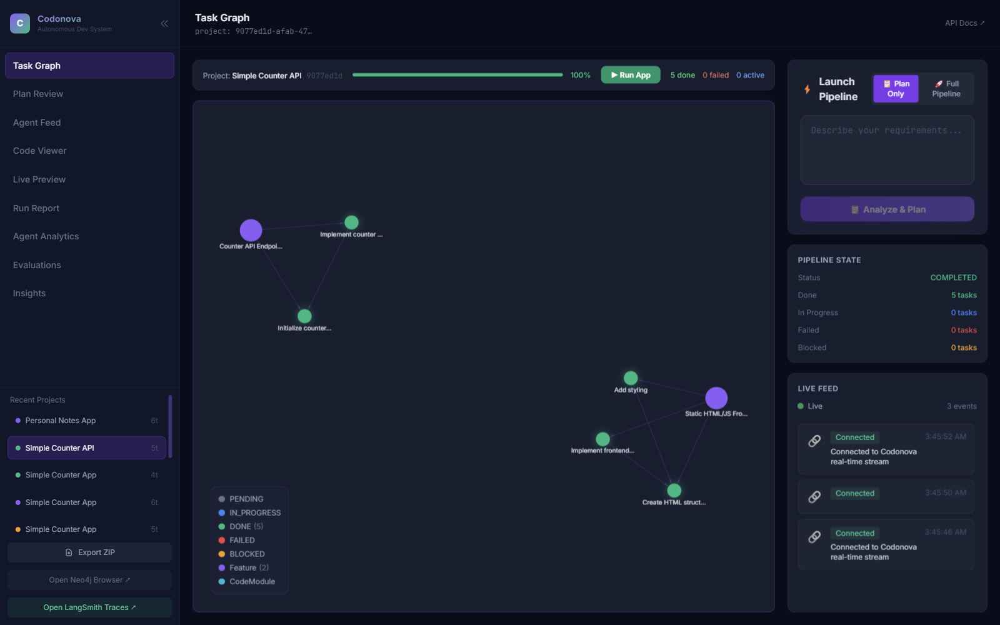
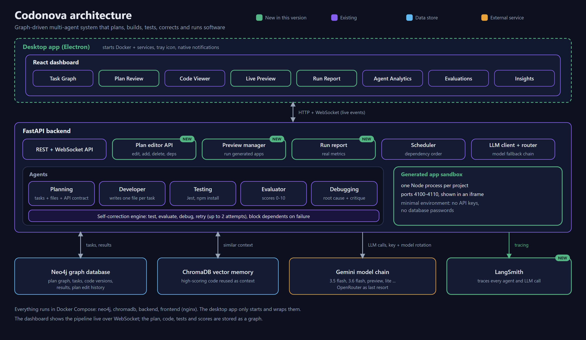
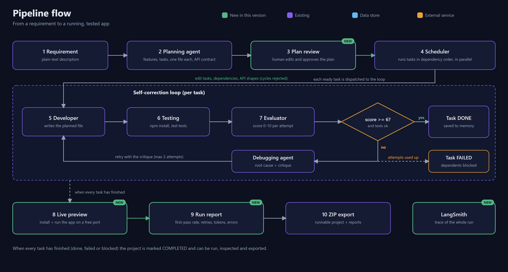
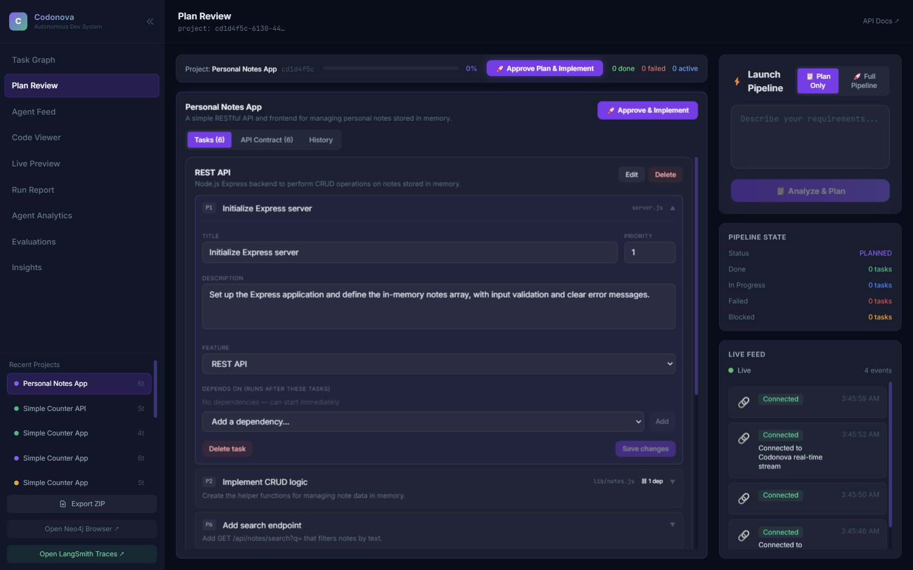
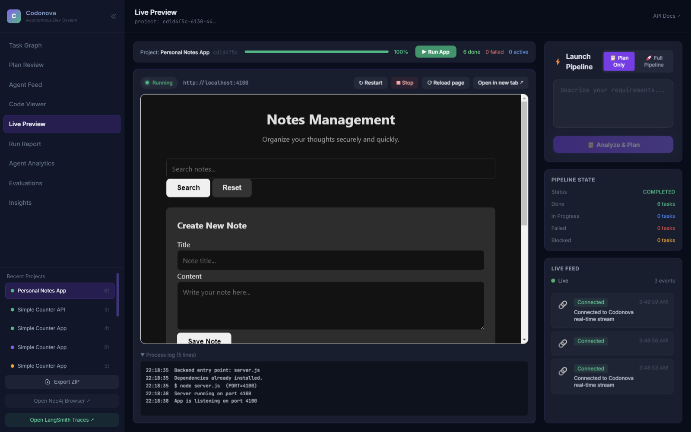
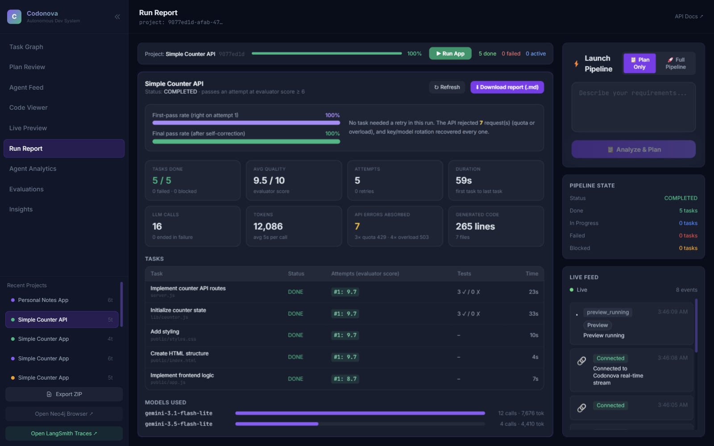
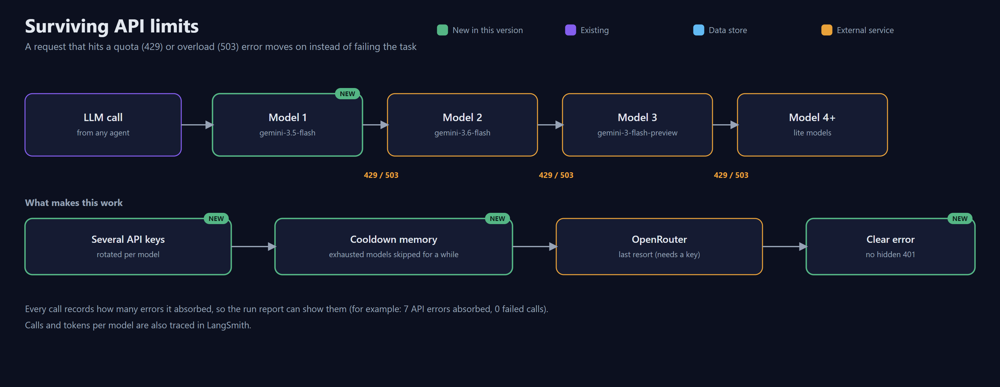

# Codonova

**Autonomous software development with deep AI agents.** Give it a requirement in plain text. It plans the work as a task graph, lets you review and edit the plan, writes the code, tests it, scores it, fixes what fails, and then runs the finished app for you, live, inside the dashboard.




## What it does

1. **Plans.** The Planning agent splits the requirement into features and tasks, assigns each task exactly one file, and defines the REST API contract (endpoints with request and response JSON). Everything is stored as a graph in Neo4j.
2. **You review the plan.** In **Plan Review** you can edit tasks, add or delete features and tasks, change dependencies (cycles are rejected) and edit the API contract. Every edit is kept in a history. Then you approve.
3. **Builds.** The Scheduler runs tasks in dependency order, in parallel. The Developer agent writes one file per task (Node.js/Express backend, static HTML/CSS/JS frontend).
4. **Tests and scores.** The Testing agent installs the dependencies and runs Jest tests. The Evaluator scores each attempt from 0 to 10.
5. **Corrects itself.** A task passes at a score of 6 or more. Otherwise the Debugging agent finds the root cause and the Developer retries with that critique (up to 2 attempts). A task that still fails blocks the tasks that depend on it.
6. **Runs the result.** **Live Preview** installs the generated app's packages, starts it on a free port and shows it in the dashboard.
7. **Reports.** **Run Report** shows first-pass and final pass rate, retries, tests, time per task, tokens and the API errors that were absorbed. The same report is exported as `RUN_REPORT.md`.
8. **Remembers.** Code that scored well is stored in ChromaDB and reused as context for similar tasks.

## Architecture





| Layer | Technology |
|---|---|
| Dashboard | React 18, Vite, Tailwind, react-force-graph, Recharts |
| Desktop shell | Electron (starts Docker and the services, tray, notifications) |
| Backend | Python 3.11, FastAPI, WebSocket |
| Graph database | Neo4j 5 (plan, tasks, code versions, test and evaluation results, plan edits) |
| Vector memory | ChromaDB (built-in ONNX embeddings) |
| LLMs | Gemini through its OpenAI-compatible API, with a model fallback chain; OpenRouter as last resort |
| Observability | Optional LangSmith tracing, plus the built-in Run Report and Agent Analytics |
| Generated apps | Node.js, Express, Jest |

## Quick start

Requirements: Docker Desktop and a free [Gemini API key](https://aistudio.google.com).

```bash
cp .env.example .env      # then add GEMINI_API_KEY and a NEO4J_PASSWORD
docker compose up -d --build
```

| Service | URL |
|---|---|
| Dashboard | http://localhost:3000 |
| API docs | http://localhost:8000/docs |
| Neo4j Browser | http://localhost:7474 |
| Generated app preview | http://localhost:4100 to 4110 |

### Desktop app

A native window that starts everything for you. See [desktop/README.md](desktop/README.md).

```bash
cd desktop
npm install
npm start          # run from source
npm run dist       # build the Windows installer
```

## Using it

1. Describe what to build and choose **Plan Only** (review first) or **Full Pipeline** (no review).
2. **Plan Review**: edit the plan, check the API Contract tab, then **Approve & Implement**.
3. Watch the **Task Graph** and **Agent Feed** fill in live.
4. When it finishes, press **Run App** (Live Preview), open **Run Report**, or **Export ZIP**.







### Through the API

```bash
# plan only
curl -X POST http://localhost:8000/api/plan -H "Content-Type: application/json" \
  -d '{"requirement": "A notes app with a REST API and a simple web page"}'

# approve and run an existing plan
curl -X POST http://localhost:8000/api/execute/{project_id}

# plan and run in one step
curl -X POST http://localhost:8000/api/start -H "Content-Type: application/json" \
  -d '{"requirement": "..."}'
```

| Endpoint | Purpose |
|---|---|
| `GET /api/projects/{id}/plan` | The editable plan (features, tasks, dependencies, API contract) |
| `PATCH /api/tasks/{id}`, `POST /api/projects/{id}/tasks`, `DELETE /api/tasks/{id}` | Edit tasks |
| `POST /api/tasks/{id}/dependencies`, `DELETE /api/tasks/{id}/dependencies/{dep}` | Edit dependencies |
| `PUT /api/projects/{id}/api-schema` | Edit the API contract |
| `GET /api/projects/{id}/revisions` | Plan edit history |
| `POST /api/preview/{id}/start`, `.../stop`, `.../restart`, `GET .../status` | Live Preview |
| `GET /api/report/{id}`, `GET /api/report/{id}/markdown` | Run Report |
| `GET /api/export/{id}` | ZIP of the runnable project and reports |
| `GET /api/status/{id}`, `GET /api/graph/{id}` | Progress and task graph |
| `GET /api/analytics/agents`, `GET /api/insights` | Agent analytics |
| `WS /ws/progress` | Live event stream |

## Surviving API limits



`GEMINI_MODEL` takes a comma-separated chain. When a model returns a quota (429) or overload (503) error, the next key or model is tried, exhausted models are skipped for a while, and OpenRouter is used only if a key is configured. Each call records how many errors it absorbed, and the Run Report shows the total.

## LLM configuration

| Setting | Meaning |
|---|---|
| `GEMINI_API_KEY` | One key, or several separated by commas (rotated on quota errors) |
| `GEMINI_MODEL` | Model chain, in priority order |
| `OPENROUTER_API_KEY`, `OPENROUTER_MODEL` | Optional last-resort fallback |
| `LANGSMITH_TRACING`, `LANGSMITH_API_KEY`, `LANGSMITH_PROJECT` | Optional tracing of every agent and LLM call |

## Neo4j graph schema

```
Project ──HAS_FEATURE──► Feature ──HAS_TASK──► Task ──DEPENDS_ON──► Task
   │                                             ▲
   ├──HAS_REVISION──► PlanRevision               └── CodeModule ──PRODUCED_BY (one per attempt)
   │                                                      ▲
   └──HAS_REQUIREMENT──► Requirement   TestResult ──VALIDATES──┤
                                       EvaluationResult ──EVALUATES──┘
                                       Bug ──FAILED_BY──► CodeModule ◄── Fix
LLMCallLog (per call: agent, model, tokens, latency, absorbed errors)    Agent ──LEARNED_FROM──► LearningNode
```

## Benchmark

`backend/benchmark.py` runs several requirements end to end and writes one row per run (pass rates, retries, time, tokens, absorbed API errors) to a CSV.

```bash
python backend/benchmark.py --count 2
```

Each run makes dozens of LLM calls, so mind the free-tier quota.

## Repository layout

```
backend/
  agents/            planning, developer, testing, evaluator, debugging, correction engine, scheduler
  graph/             Neo4j client (all Cypher)
  memory/            ChromaDB memory and context retrieval
  llm_client.py      the only place LLMs are called: key and model rotation, tracing hooks
  plan_editor.py     plan review API
  preview_manager.py live preview of generated apps
  project_runtime.py dependency scan, package.json, npm install
  run_report.py      run report and markdown export
  tracing.py         optional LangSmith integration
  benchmark.py       benchmark runner
frontend/src/        React dashboard (components for each panel)
desktop/             Electron desktop app
docs/                screenshots and diagrams
docker-compose.yml   neo4j, chromadb, backend, frontend
```

## Generated output

The ZIP export (`GET /api/export/{id}`) contains the complete runnable project (`server.js`, `lib/`, `public/`, `tests/`, `package.json`), a `README.md`, `RUN_REPORT.md`, `EVALUATION_REPORT.md` and `test_report.json`.
